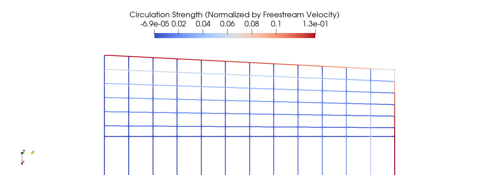
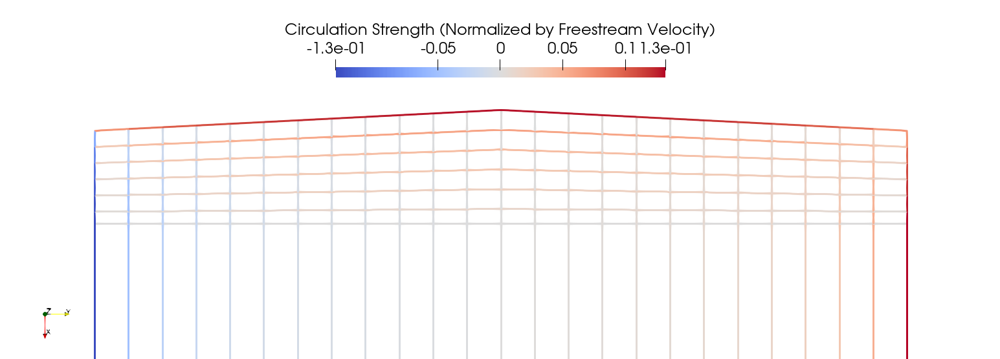
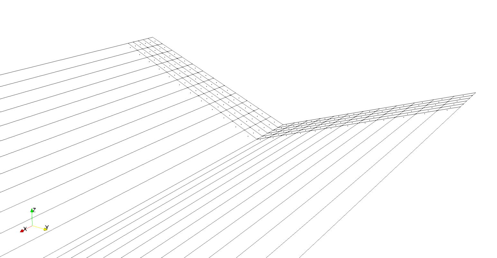
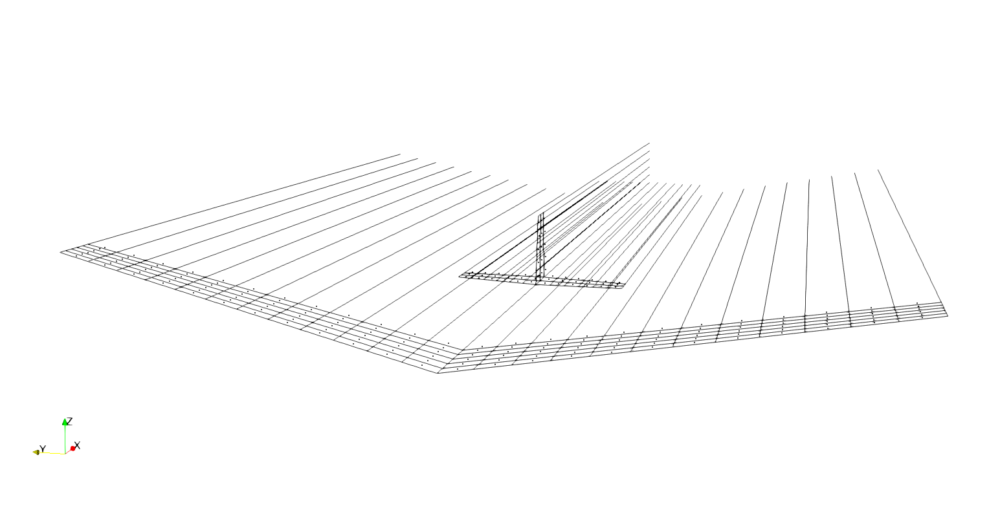
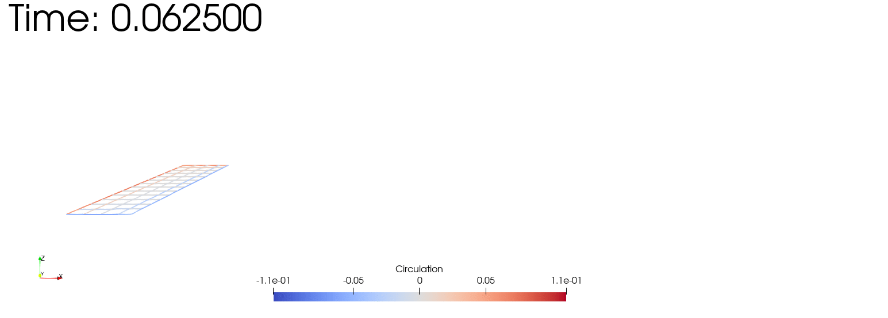
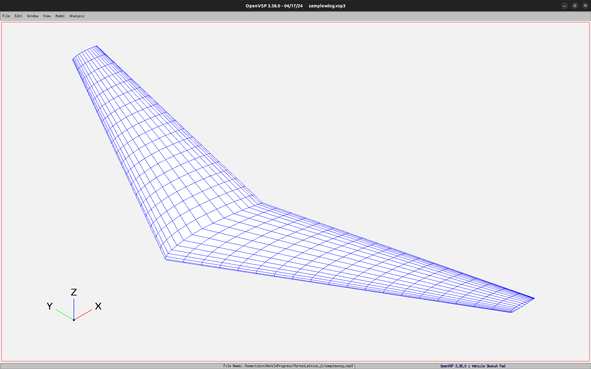
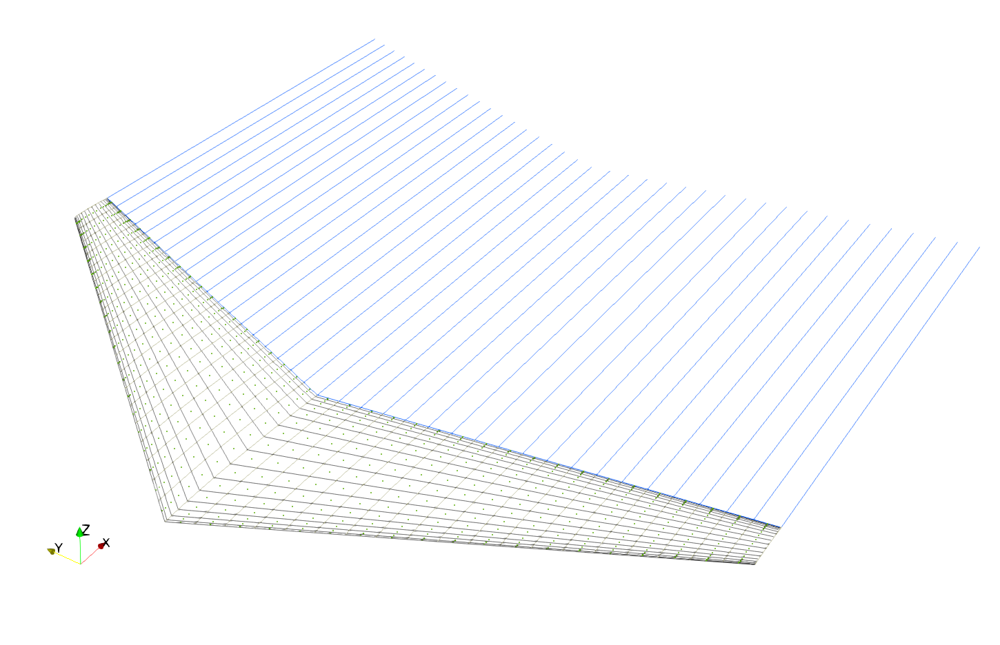

# Examples

These examples show how to use VortexLattice for various geometries, flow conditions, and analyses.  Many of these examples also provide a verification for the implementation of the vortex lattice method in this package.

```@contents
Pages = ["examples.md"]
Depth = 3
```

## Steady State Analysis of a Wing

This example shows how to calculate aerodynamic coefficients and stability derivatives for a symmetric planar wing.

```@example planar-wing
using VortexLattice

# geometry (right half of the wing)
xle = [0.0, 0.4]
yle = [0.0, 7.5]
zle = [0.0, 0.0]
chord = [2.2, 1.8]
theta = [2.0*pi/180, 2.0*pi/180]
phi = [0.0, 0.0]
fc = fill((xc) -> 0, 2) # camberline function for each section

# discretization parameters
ns = 12
nc = 6
spacing_s = Uniform()
spacing_c = Uniform()

# reference parameters
Sref = 30.0
cref = 2.0
bref = 15.0
rref = [0.50, 0.0, 0.0]
Vinf = 1.0
ref = Reference(Sref, cref, bref, rref, Vinf)

# freestream parameters
alpha = 1.0*pi/180
beta = 0.0
Omega = [0.0; 0.0; 0.0]

# construct grid
grid, ratio = wing_to_grid(xle, yle, zle, chord, theta, phi, ns, nc;
    fc = fc, spacing_s=spacing_s, spacing_c=spacing_c)

# create vector containing all grids
grids=[grid]
ratios=[ratio]

# Construct the system
system = VortexLatticeSystem(grids; ratios)

# we can use symmetry since the geometry and flow conditions are symmetric about the X-Z axis
symmetric = true

# perform steady state analysis
steady_analysis!(system, ref, flight_condition(system, ref, Vinf; alpha, beta, rates = Omega)...; symmetric=symmetric)

# retrieve near-field forces
CF, CM = body_forces(system; frame=Wind())

# perform far-field analysis
CDiff = far_field_drag(system)

CD, CY, CL = CF
Cl, Cm, Cn = CM

nothing # hide
```

The aerodynamic coefficients predicted by VortexLattice are nearly identical to those predicted by AVL.

```@example planar-wing
using PrettyTables # hide
using Markdown # hide

CD_avl = 0.00247 # hide
CL_avl = 0.24454 # hide
Cm_avl = -0.02091 # hide
CDiff_avl = 0.00248 # hide

table = [  # hide
"``C_L``" CL CL_avl CL-CL_avl;  # hide
"``C_{Di}`` (nearfield)" CD CD_avl CD-CD_avl;  # hide
"``C_{Di}`` (farfield)" CDiff CDiff_avl CDiff-CDiff_avl;  # hide
"``C_M``" Cm Cm_avl Cm-Cm_avl  # hide
]  # hide
header = ["Coefficient", "VortexLattice", "AVL", "Difference"]  # hide

str = pretty_table(String, table; #hide
    backend=Val(:text), # hide
    header=(header,), # hide
    tf = tf_markdown, # hide
    alignment=[:l, :r, :r, :r], # hide
    formatters = (ft_printf("%0.5f", [2,3]), ft_printf("%0.1e", 4))) # hide

Markdown.parse(str) # hide
```

We can also generate files to visualize the results in Paraview using the function `write_vtk`.

```julia
write_vtk("symmetric-planar-wing", system)
```



For asymmetric flow conditions and/or to obtain accurate asymmetric stability derivatives we can use the keyword argument `mirror` when constructing the geometry to reflect the geometry across the X-Z plane prior to the analysis.  We also set the `symmetric` flag to `false` since we are no longer using symmetry in the analysis.

```@example planar-wing

# construct geometry with mirror image
grid, ratio = wing_to_grid(xle, yle, zle, chord, theta, phi, ns, nc;
    fc=fc, spacing_s=spacing_s, spacing_c=spacing_c, mirror=true)

# symmetry is not used in the analysis
symmetric = false

# create vector containing all grids
grids=[grid]
ratios=[ratio]

# Construct the system
system = VortexLatticeSystem(grids; ratios)

# perform steady state analysis
steady_analysis!(system, ref, flight_condition(system, ref, Vinf; alpha, beta, rates = Omega)...; symmetric=symmetric)

# retrieve near-field forces
CF, CM = body_forces(system; frame=Wind())

# perform far-field analysis
CDiff = far_field_drag(system)

CD, CY, CL = CF
Cl, Cm, Cn = CM

nothing # hide
```

Once again, the aerodynamic coefficients predicted by VortexLattice are nearly identical to those predicted by AVL.

```@example planar-wing
using PrettyTables # hide
using Markdown # hide

CD_avl = 0.00247 # hide
CL_avl = 0.24454 # hide
Cm_avl = -0.02091 # hide
CDiff_avl = 0.00248 # hide

table = [ # hide
"``C_L``" CL CL_avl CL-CL_avl; # hide
"``C_{Di}`` (nearfield)" CD CD_avl CD-CD_avl; # hide
"``C_{Di}`` (farfield)" CDiff CDiff_avl CDiff-CDiff_avl; # hide
"``C_M``" Cm Cm_avl Cm-Cm_avl # hide
] # hide
header = ["Coefficient", "VortexLattice", "AVL", "Difference"] # hide

str = pretty_table(String, table; # hide
    backend=Val(:text), # hide
    header=(header,), # hide
    tf = tf_markdown, # hide
    alignment=[:l, :r, :r, :r], # hide
    formatters = (ft_printf("%0.5f", [2,3]), ft_printf("%0.1e", 4))) # hide

Markdown.parse(str) # hide
```

The stability derivatives are also very close to those predicted by AVL.

```@example planar-wing

dCF, dCM = stability_derivatives(system)

CDa, CYa, CLa = dCF.alpha
Cla, Cma, Cna = dCM.alpha
CDb, CYb, CLb = dCF.beta
Clb, Cmb, Cnb = dCM.beta
CDp, CYp, CLp = dCF.p
Clp, Cmp, Cnp = dCM.p
CDq, CYq, CLq = dCF.q
Clq, Cmq, Cnq = dCM.q
CDr, CYr, CLr = dCF.r
Clr, Cmr, Cnr = dCM.r

nothing # hide
```

```@example planar-wing
using PrettyTables # hide
using Markdown # hide

CLa_avl =   4.663214 # hide
CLb_avl =   0.0 # hide
CYa_avl =   0.0 # hide
CYb_avl =  -0.000002 # hide
Cla_avl =   0.0 # hide
Clb_avl =  -0.025435 # hide
Cma_avl =  -0.397758 # hide
Cmb_avl =   0.0 # hide
Cna_avl =   0.0 # hide
Cnb_avl =   0.000452 # hide
CLp_avl =   0.0 # hide
CLq_avl =   5.649411 # hide
CLr_avl =   0.0 # hide
CYp_avl =   0.049063 # hide
CYq_avl =   0.0 # hide
CYr_avl =  -0.000828 # hide
Clp_avl =  -0.524750 # hide
Clq_avl =   0.0 # hide
Clr_avl =   0.064456 # hide
Cmp_avl =   0.0 # hide
Cmq_avl =  -1.270212 # hide
Cmr_avl =   0.0 # hide
Cnp_avl =  -0.019175 # hide
Cnq_avl =   0.0 # hide
Cnr_avl =  -0.000931 # hide

table = [ # hide
"``C_{La}``" CLa CLa_avl CLa-CLa_avl; # hide
"``C_{Lb}``" CLb CLb_avl CLb-CLb_avl; # hide
"``C_{Ya}``" CYa CYa_avl CYa-CYa_avl; # hide
"``C_{Yb}``" CYb CYb_avl CYb-CYb_avl; # hide
"``C_{la}``" Cla Cla_avl Cla-Cla_avl; # hide
"``C_{lb}``" Clb Clb_avl Clb-Clb_avl; # hide
"``C_{ma}``" Cma Cma_avl Cma-Cma_avl; # hide
"``C_{mb}``" Cmb Cmb_avl Cmb-Cmb_avl; # hide
"``C_{na}``" Cna Cna_avl Cna-Cna_avl; # hide
"``C_{nb}``" Cnb Cnb_avl Cnb-Cnb_avl; # hide
"``C_{Lp}``" CLp CLp_avl CLp-CLp_avl; # hide
"``C_{Lq}``" CLq CLq_avl CLq-CLq_avl; # hide
"``C_{Lr}``" CLr CLr_avl CLr-CLr_avl; # hide
"``C_{Yp}``" CYp CYp_avl CYp-CYp_avl; # hide
"``C_{Yq}``" CYq CYq_avl CYq-CYq_avl; # hide
"``C_{Yr}``" CYr CYr_avl CYr-CYr_avl; # hide
"``C_{lp}``" Clp Clp_avl Clp-Clp_avl; # hide
"``C_{lq}``" Clq Clq_avl Clq-Clq_avl; # hide
"``C_{lr}``" Clr Clr_avl Clr-Clr_avl; # hide
"``C_{mp}``" Cmp Cmp_avl Cmp-Cmp_avl; # hide
"``C_{mq}``" Cmq Cmq_avl Cmq-Cmq_avl; # hide
"``C_{mr}``" Cmr Cmr_avl Cmr-Cmr_avl; # hide
"``C_{np}``" Cnp Cnp_avl Cnp-Cnp_avl; # hide
"``C_{nq}``" Cnq Cnq_avl Cnq-Cnq_avl; # hide
"``C_{nr}``" Cnr Cnr_avl Cnr-Cnr_avl; # hide
] # hide
header = ["Coefficient", "VortexLattice", "AVL", "Difference"] # hide

str = pretty_table(String, table; # hide
    backend=Val(:text), # hide
    header=(header,), # hide
    tf = tf_markdown, # hide
    alignment=[:l, :r, :r, :r], # hide
    formatters = (ft_printf("%0.5f", [2,3]), ft_printf("%0.1e", 4))) # hide

Markdown.parse(str) # hide
```

Visualizing the geometry now shows the circulation distribution across the entire wing.

```julia
write_vtk("mirrored-planar-wing", system)
```



## Steady State Analysis of a Wing with Dihedral

This example shows how to calculate aerodynamic coefficients and stability derivatives for a simple wing with dihedral.

```@example wing-with-dihedral
using VortexLattice

xle = [0.0, 0.4]
yle = [0.0, 7.5]
zle = [0.0, 3.0]
chord = [2.2, 1.8]
theta = [2.0*pi/180, 2.0*pi/180]
phi = [0.0, 0.0]
fc = fill((xc) -> 0, 2) #camberline function for each section

ns = 12
nc = 6
spacing_s = Uniform()
spacing_c = Uniform()
mirror = false
symmetric = true

Sref = 30.0
cref = 2.0
bref = 15.0
rref = [0.50, 0.0, 0.0]
Vinf = 1.0
ref = Reference(Sref, cref, bref, rref, Vinf)

alpha = 1.0*pi/180
beta = 0.0
Omega = [0.0; 0.0; 0.0]

# declare symmetry
symmetric = true

# construct surface
grid, ratio = wing_to_grid(xle, yle, zle, chord, theta, phi, ns, nc;
    fc = fc, spacing_s=spacing_s, spacing_c=spacing_c)

# create vector containing all grids and ratios
grids = [grid]
ratios = [ratio]

# create the system object
system = VortexLatticeSystem(grids; ratios)

# perform steady state analysis
steady_analysis!(system, ref, flight_condition(system, ref, Vinf; alpha, beta, rates = Omega)...; symmetric=symmetric)

# retrieve near-field forces
CF, CM = body_forces(system; frame=Wind())

# perform far-field analysis
CDiff = far_field_drag(system)

CD, CY, CL = CF
Cl, Cm, Cn = CM

nothing # hide
```

The results predicted by VortexLattice are close to those predicted by AVL, with the difference primarily explained by the manner in which the normal vector is defined in VortexLattice and AVL, respectively.

```@example wing-with-dihedral
using PrettyTables # hide
using Markdown # hide

CD_avl = 0.00248 # hide
CL_avl = 0.24808 # hide
Cm_avl = -0.02250 # hide
CDiff_avl = 0.0024671 # hide

table = [ # hide
"``C_L``" CL CL_avl CL-CL_avl; # hide
"``C_{Di}`` (nearfield)" CD CD_avl CD-CD_avl; # hide
"``C_{Di}`` (farfield)" CDiff CDiff_avl CDiff-CDiff_avl; # hide
"``C_M``" Cm Cm_avl Cm-Cm_avl # hide
] # hide
header = ["Coefficient", "VortexLattice", "AVL", "Difference"] # hide

str = pretty_table(String, table; # hide
    backend=Val(:text), # hide
    header=(header,), # hide
    tf = tf_markdown, # hide
    alignment=[:l, :r, :r, :r], # hide
    formatters = (ft_printf("%0.5f", [2,3]), ft_printf("%0.1e", 4))) # hide

Markdown.parse(str) # hide
```

If we set the normal vectors in VortexLattice equal to those used in AVL, the results are even closer, though not necessarily more accurate.

```@example wing-with-dihedral

using LinearAlgebra

# function to construct a normal vector the way AVL does
#  - `ds` is a line representing the leading edge
#  - `theta` is the incidence angle, taken as a rotation (+ by RH rule) about
#        the surface's spanwise axis projected onto the Y-Z plane.
function avl_normal_vector(ds, theta)

    st, ct = sincos(theta)

    # bound vortex vector
    bhat = ds/norm(ds)

    # chordwise strip normal vector
    shat = [0, -ds[3], ds[2]]/sqrt(ds[2]^2+ds[3]^2)

    # camberline vector
    chat = [ct, -st*shat[2], -st*shat[3]]

    # normal vector perpindicular to camberline and bound vortex for entire chordwise strip
    ncp = cross(chat, ds)
    return ncp / norm(ncp) # normal vector used by AVL
end

# new normal vector
ncp = avl_normal_vector([xle[2]-xle[1], yle[2]-yle[1], zle[2]-zle[1]], 2.0*pi/180)

# overwrite normal vector for each panel
for i = 1:length(system.surfaces[1])
    system.surfaces[1][i] = set_normal(system.surfaces[1][i], ncp)
end

# perform steady state analysis
steady_analysis!(system, ref, flight_condition(system, ref, Vinf; alpha, beta, rates = Omega)...; symmetric=symmetric)

# retrieve near-field forces
CF, CM = body_forces(system; frame=Wind())

# perform far-field analysis
CDiff = far_field_drag(system)

CD, CY, CL = CF
Cl, Cm, Cn = CM

nothing # hide
```

```@example wing-with-dihedral
using PrettyTables # hide
using Markdown # hide

CD_avl = 0.00248 # hide
CL_avl = 0.24808 # hide
Cm_avl = -0.02250 # hide
CDiff_avl = 0.0024671 # hide

table = [ # hide
"``C_L``" CL CL_avl CL-CL_avl; # hide
"``C_{Di}`` (nearfield)" CD CD_avl CD-CD_avl; # hide
"``C_{Di}`` (farfield)" CDiff CDiff_avl CDiff-CDiff_avl; # hide
"``C_M``" Cm Cm_avl Cm-Cm_avl # hide
] # hide
header = ["Coefficient", "VortexLattice", "AVL", "Difference"] # hide

str = pretty_table(String, table; # hide
    backend=Val(:text), # hide
    header=(header,), # hide
    tf = tf_markdown, # hide
    alignment=[:l, :r, :r, :r], # hide
    formatters = (ft_printf("%0.5f", [2,3]), ft_printf("%0.1e", 4))) # hide

Markdown.parse(str) # hide
```

```julia
write_vtk("wing-with-dihedral", system)
```



## Steady State Analysis of a Wing and Tail

This example shows how to calculate aerodynamic coefficients and stability derivatives for multiple lifting surfaces.

```@example wing-tail
using VortexLattice

# wing
xle = [0.0, 0.2]
yle = [0.0, 5.0]
zle = [0.0, 1.0]
chord = [1.0, 0.6]
theta = [2.0*pi/180, 2.0*pi/180]
phi = [0.0, 0.0]
fc = fill((xc) -> 0, 2) # camberline function for each section
ns = 12
nc = 6
spacing_s = Uniform()
spacing_c = Uniform()
mirror = false

# horizontal stabilizer
xle_h = [0.0, 0.14]
yle_h = [0.0, 1.25]
zle_h = [0.0, 0.0]
chord_h = [0.7, 0.42]
theta_h = [0.0, 0.0]
phi_h = [0.0, 0.0]
fc_h = fill((xc) -> 0, 2) #camberline function for each section
ns_h = 6
nc_h = 3
spacing_s_h = Uniform()
spacing_c_h = Uniform()
mirror_h = false

# vertical stabilizer
xle_v = [0.0, 0.14]
yle_v = [0.0, 0.0]
zle_v = [0.0, 1.0]
chord_v = [0.7, 0.42]
theta_v = [0.0, 0.0]
phi_v = [0.0, 0.0]
fc_v = fill((xc) -> 0, 2) #camberline function for each section
ns_v = 5
nc_v = 3
spacing_s_v = Uniform()
spacing_c_v = Uniform()
mirror_v = false

Sref = 9.0
cref = 0.9
bref = 10.0
rref = [0.5, 0.0, 0.0]
Vinf = 1.0
ref = Reference(Sref, cref, bref, rref, Vinf)

alpha = 5.0*pi/180
beta = 0.0
Omega = [0.0; 0.0; 0.0]

symmetric = [true, true, false]

# generate surface panels for wing
wgrid, wratio = wing_to_grid(xle, yle, zle, chord, theta, phi, ns, nc;
    mirror=mirror, fc = fc, spacing_s=spacing_s, spacing_c=spacing_c)

# generate surface panels for horizontal tail
hgrid, hratio = wing_to_grid(xle_h, yle_h, zle_h, chord_h, theta_h, phi_h, ns_h, nc_h;
    mirror=mirror_h, fc=fc_h, spacing_s=spacing_s_h, spacing_c=spacing_c_h)
translate!(hgrid, [4.0, 0.0, 0.0])

# generate surface panels for vertical tail
vgrid, vratio = wing_to_grid(xle_v, yle_v, zle_v, chord_v, theta_v, phi_v, ns_v, nc_v;
    mirror=mirror_v, fc=fc_v, spacing_s=spacing_s_v, spacing_c=spacing_c_v)
translate!(vgrid, [4.0, 0.0, 0.0])

grids = [wgrid, hgrid, vgrid]
ratios = [wratio, hratio, vratio]
surface_id = [1, 2, 3]

system = VortexLatticeSystem(grids; ratios)

steady_analysis!(system, ref, flight_condition(system, ref, Vinf; alpha, beta, rates = Omega)...; symmetric=symmetric, surface_id=surface_id)

CF, CM = body_forces(system; frame=Wind())

CDiff = far_field_drag(system)

CD, CY, CL = CF
Cl, Cm, Cn = CM

nothing # hide
```

The results predicted by VortexLattice are close to those predicted by AVL (with the finite core model disabled in AVL), with the difference primarily explained by the manner in which the normal vector is defined in VortexLattice and AVL, respectively.

```@example wing-tail
using PrettyTables # hide
using Markdown # hide

CD_avl = 0.01060 # hide
CL_avl = 0.60478 # hide
Cm_avl = -0.02700 # hide
CDiff_avl = 0.0104282 # hide

table = [ # hide
"``C_L``" CL CL_avl CL-CL_avl; # hide
"``C_{Di}`` (nearfield)" CD CD_avl CD-CD_avl; # hide
"``C_{Di}`` (farfield)" CDiff CDiff_avl CDiff-CDiff_avl; # hide
"``C_M``" Cm Cm_avl Cm-Cm_avl # hide
] # hide
header = ["Coefficient", "VortexLattice", "AVL", "Difference"] # hide

str = pretty_table(String, table; # hide
    backend=Val(:text), # hide
    header=(header,), # hide
    tf = tf_markdown, # hide
    alignment=[:l, :r, :r, :r], # hide
    formatters = (ft_printf("%0.5f", [2,3]), ft_printf("%0.1e", 4))) # hide

Markdown.parse(str) # hide
```

If we set the normal vectors in VortexLattice equal to those used in AVL, the results are closer, though not necessarily more accurate.

```@example wing-tail

using LinearAlgebra

# function to construct a normal vector the way AVL does
#  - `ds` is a line representing the leading edge
#  - `theta` is the incidence angle, taken as a rotation (+ by RH rule) about
#        the surface's spanwise axis projected onto the Y-Z plane.
function avl_normal_vector(ds, theta)

    st, ct = sincos(theta)

    # bound vortex vector
    bhat = ds/norm(ds)

    # chordwise strip normal vector
    shat = [0, -ds[3], ds[2]]/sqrt(ds[2]^2+ds[3]^2)

    # camberline vector
    chat = [ct, -st*shat[2], -st*shat[3]]

    # normal vector perpindicular to camberline and bound vortex for entire chordwise strip
    ncp = cross(chat, ds)
    return ncp / norm(ncp) # normal vector used by AVL
end

# new normal vector for the wing
ncp = avl_normal_vector([xle[2]-xle[1], yle[2]-yle[1], zle[2]-zle[1]], 2.0*pi/180)

# overwrite normal vector for each wing panel
for i = 1:length(system.surfaces[1])
    system.surfaces[1][i] = set_normal(system.surfaces[1][i], ncp)
end

# perform steady state analysis
steady_analysis!(system, ref, flight_condition(system, ref, Vinf; alpha, beta, rates = Omega)...; symmetric=symmetric)

# retrieve near-field forces
CF, CM = body_forces(system; frame=Wind())

# perform far-field analysis
CDiff = far_field_drag(system)

CD, CY, CL = CF
Cl, Cm, Cn = CM

nothing # hide
```

```@example wing-tail
using PrettyTables # hide
using Markdown # hide

CD_avl = 0.01060 # hide
CL_avl = 0.60478 # hide
Cm_avl = -0.02700 # hide
CDiff_avl = 0.0104282 # hide

table = [ # hide
"``C_L``" CL CL_avl CL-CL_avl; # hide
"``C_{Di}`` (nearfield)" CD CD_avl CD-CD_avl; # hide
"``C_{Di}`` (farfield)" CDiff CDiff_avl CDiff-CDiff_avl; # hide
"``C_M``" Cm Cm_avl Cm-Cm_avl # hide
] # hide
header = ["Coefficient", "VortexLattice", "AVL", "Difference"] # hide

str = pretty_table(String, table; # hide
    backend=Val(:text), # hide
    header=(header,), # hide
    tf = tf_markdown, # hide
    alignment=[:l, :r, :r, :r], # hide
    formatters = (ft_printf("%0.5f", [2,3]), ft_printf("%0.1e", 4))) # hide

Markdown.parse(str) # hide
```

To achieve a theoretically identical setup as AVL we can place all our panels in the X-Y plane and then set the normal vector manually to match the actual lifting geometry.  In our case this involves removing the small amount of twist on the wing when creating the wing surface panels.

```@example wing-tail
using VortexLattice

# wing
xle = [0.0, 0.2]
yle = [0.0, 5.0]
zle = [0.0, 1.0]
chord = [1.0, 0.6]
theta = [0.0, 0.0]
phi = [0.0, 0.0]
fc = fill((xc) -> 0, 2) # camberline function for each section
ns = 12
nc = 6
spacing_s = Uniform()
spacing_c = Uniform()
mirror = false

# horizontal stabilizer
xle_h = [0.0, 0.14]
yle_h = [0.0, 1.25]
zle_h = [0.0, 0.0]
chord_h = [0.7, 0.42]
theta_h = [0.0, 0.0]
phi_h = [0.0, 0.0]
fc_h = fill((xc) -> 0, 2) # camberline function for each section
ns_h = 6
nc_h = 3
spacing_s_h = Uniform()
spacing_c_h = Uniform()
mirror_h = false

# vertical stabilizer
xle_v = [0.0, 0.14]
yle_v = [0.0, 0.0]
zle_v = [0.0, 1.0]
chord_v = [0.7, 0.42]
theta_v = [0.0, 0.0]
phi_v = [0.0, 0.0]
fc_v = fill((xc) -> 0, 2) # camberline function for each section
ns_v = 5
nc_v = 3
spacing_s_v = Uniform()
spacing_c_v = Uniform()
mirror_v = false

Sref = 9.0
cref = 0.9
bref = 10.0
rref = [0.5, 0.0, 0.0]
Vinf = 1.0
ref = Reference(Sref, cref, bref, rref, Vinf)

alpha = 5.0*pi/180
beta = 0.0
Omega = [0.0; 0.0; 0.0]

symmetric = [true, true, false]

# generate surface panels for wing
wgrid, wratio = wing_to_grid(xle, yle, zle, chord, theta, phi, ns, nc;
    mirror=mirror, fc=fc, spacing_s=spacing_s, spacing_c=spacing_c)

# generate surface panels for horizontal tail
hgrid, hratio = wing_to_grid(xle_h, yle_h, zle_h, chord_h, theta_h, phi_h, ns_h, nc_h;
    mirror=mirror_h, fc=fc_h, spacing_s=spacing_s_h, spacing_c=spacing_c_h)
translate!(hgrid, [4.0, 0.0, 0.0])

# generate surface panels for vertical tail
vgrid, vratio = wing_to_grid(xle_v, yle_v, zle_v, chord_v, theta_v, phi_v, ns_v, nc_v;
    mirror=mirror_v, fc=fc_v, spacing_s=spacing_s_v, spacing_c=spacing_c_v)
translate!(vgrid, [4.0, 0.0, 0.0])

# now set normal vectors manually
ncp = avl_normal_vector([xle[2]-xle[1], yle[2]-yle[1], zle[2]-zle[1]], 2.0*pi/180)

grids = [wgrid, hgrid, vgrid]
ratios = [wratio, hratio, vratio]
surface_id = [1, 2, 3]

system = VortexLatticeSystem(grids; ratios)

# overwrite normal vector for each wing panel
for i = 1:length(system.surfaces[1])
    system.surfaces[1][i] = set_normal(system.surfaces[1][i], ncp)
end

steady_analysis!(system, ref, flight_condition(system, ref, Vinf; alpha, beta, rates = Omega)...; symmetric=symmetric, surface_id=surface_id)

CF, CM = body_forces(system; frame=Stability())

CDiff = far_field_drag(system)

CD, CY, CL = CF
Cl, Cm, Cn = CM

nothing # hide
```

The resulting aerodynamic coefficients now match very closely with AVL.

```@example wing-tail
using PrettyTables # hide
using Markdown # hide

CD_avl = 0.01060 # hide
CL_avl = 0.60478 # hide
Cm_avl = -0.02700 # hide
CDiff_avl = 0.0104282 # hide

table = [ # hide
"``C_L``" CL CL_avl CL-CL_avl; # hide
"``C_{Di}`` (nearfield)" CD CD_avl CD-CD_avl; # hide
"``C_{Di}`` (farfield)" CDiff CDiff_avl CDiff-CDiff_avl; # hide
"``C_M``" Cm Cm_avl Cm-Cm_avl # hide
] # hide
header = ["Coefficient", "VortexLattice", "AVL", "Difference"] # hide

str = pretty_table(String, table; # hide
    backend=Val(:text), # hide
    header=(header,), # hide
    tf = tf_markdown, # hide
    alignment=[:l, :r, :r, :r], # hide
    formatters = (ft_printf("%0.5f", [2,3]), ft_printf("%0.1e", 4))) # hide

Markdown.parse(str) # hide
```

By comparing these results with previous results we can see exactly how much restricting surface panels in the X-Y plane changes the results from the vortex lattice method.

```julia
write_vtk("wing-tail", system)
```



## Sudden Acceleration of a Rectangular Wing into a Constant-Speed Forward Flight

This example shows how to predict the transient forces and moments on a rectangular wing when suddenly accelerated into forward flight at a five degree angle.

The time domain runs on [FLOWUnsteadyCore](https://github.com/byuflowlab/FLOWUnsteadyCore.jl): `surface_bodies` turns the surfaces of a `VortexLatticeSystem` into the core's bodies, and the core's `simulate!` (re-exported by VortexLattice) steps them with a wake. Keeping every shed row as a vortex ring (`nwakerows` at least the number of steps) is the classical unsteady vortex lattice method; with fewer rows the older wake becomes vortex particles. A `ForcesMonitor` records the force and moment coefficients after every step.

```@example rectangular-wing-sudden-acceleration
# Katz and Plotkin: Figures 13.34 and 13.35
# AR = [4, 8, 12, 20, ∞]
# Vinf*Δt/c = 1/16
# α = 5°

using VortexLattice, StaticArrays

AR = [4, 8, 12, 20, 1e3] # last aspect ratio is essentially infinite

c = 1.0              # chord length
Vinf = 1.0           # forward speed
alpha = 5.0*pi/180   # angle of attack
dt = 1/16            # time step (Vinf*dt/c)
nsteps = 160         # Vinf*t/c from 0 to 10

CF = Vector{Vector{SVector{3,Float64}}}(undef, length(AR))

for i = 1:length(AR)

    # span length
    b = AR[i]*c

    # flat rectangular wing: 13 spanwise and 4 chordwise panels
    grid, ratio = wing_to_grid([0.0, 0.0], [-b/2, b/2], [0.0, 0.0], [c, c], [0.0, 0.0], [0.0, 0.0], 13, 4;
        mirror=false, spacing_s=Uniform(), spacing_c=Uniform())
    system = VortexLatticeSystem([grid]; ratios=[ratio])
    system.reference[] = Reference(b*c, c, b, [0.0, 0.0, 0.0], Vinf)

    # the surfaces as the core's bodies, a fixed frame and the freestream
    bodies, states = surface_bodies(system)
    frames = ReferenceFrame(system; origin = SVector(0.0, 0.0, 0.0))
    freestream = Freestream(SVector(Vinf*cos(alpha), 0.0, Vinf*sin(alpha)))

    # every shed row kept as a vortex ring
    wake = PanelParticleWake(Float64, bodies; nwakerows = nsteps)

    monitor = ForcesMonitor(system, nsteps; frame=Wind())
    simulate!(states, bodies, frames, wake, freestream; nsteps, dt, monitor, backend = DirectBackend())

    CF[i] = monitor.CF
end

# the time each step's forces are reported at
t = dt .* (1:nsteps)

nothing # hide
```

Passing `path` and `name` to `simulate!` writes the surfaces and the wake to ParaView files at every step (`vtk_interval` sets the cadence).
```julia
simulate!(states, bodies, frames, wake, freestream; nsteps, dt, monitor, path = "acceleration-AR4", name = "wing")
```



The transient lift and drag coefficients are similar to those shown in Figures 13.34 and 13.35 of Low-Speed Aerodynamics by Katz and Plotkin.

```@example rectangular-wing-sudden-acceleration
using Plots

# lift coefficient plot
plot(
    xlim = (0.0, 10.0),
    xticks = 0.0:1.0:10.0,
    xlabel = "\$ \\frac{U_\\infty t}{c} \$",
    ylim = (0.0, 0.55),
    yticks = 0.0:0.1:0.5,
    ylabel = "\$ C_{L} \$",
    grid = false,
    )

for i = 1:length(AR)
    plot!(t, getindex.(CF[i], 3), label="AR = $(AR[i])")
end

savefig("rectangular-wing-sudden-acceleration-cl.svg") # hide

nothing # hide
```


```@example rectangular-wing-sudden-acceleration
# drag coefficient plot
plot(
    xlim = (0.0, 10.0),
    xticks = 0.0:1.0:10.0,
    xlabel = "\$ \\frac{U_\\infty t}{c} \$",
    ylim = (0.0, 0.030),
    yticks = 0.0:0.005:0.03,
    ylabel = "\$ C_{D} \$",
    grid = false,
    )

for i = 1:length(AR)
    plot!(t, getindex.(CF[i], 1), label="AR = $(AR[i])")
end

savefig("rectangular-wing-sudden-acceleration-cd.svg") # hide

nothing # hide
```


We modeled the problem with the wing fixed and the air moving past it, but we could equally have moved the wing through still air: a frame translating at the flight velocity and no freestream. The monitor reads the relative wind from the frame's motion.

```@example rectangular-wing-sudden-acceleration
CF_t = Vector{Vector{SVector{3,Float64}}}(undef, length(AR))

for i = 1:length(AR)

    b = AR[i]*c

    grid, ratio = wing_to_grid([0.0, 0.0], [-b/2, b/2], [0.0, 0.0], [c, c], [0.0, 0.0], [0.0, 0.0], 13, 4;
        mirror=false, spacing_s=Uniform(), spacing_c=Uniform())
    system = VortexLatticeSystem([grid]; ratios=[ratio])
    system.reference[] = Reference(b*c, c, b, [0.0, 0.0, 0.0], Vinf)

    bodies, states = surface_bodies(system)

    # the wing flies forward (-x in the grid's axes) and climbs with the 5° flight path
    frames = ReferenceFrame(system; origin = SVector(0.0, 0.0, 0.0),
        v = SVector(-Vinf*cos(alpha), 0.0, -Vinf*sin(alpha)))
    still_air = Freestream(SVector(0.0, 0.0, 0.0))

    wake = PanelParticleWake(Float64, bodies; nwakerows = nsteps)
    monitor = ForcesMonitor(system, nsteps; frame=Wind())
    simulate!(states, bodies, frames, wake, still_air; nsteps, dt, monitor, backend = DirectBackend())

    CF_t[i] = monitor.CF
end

# largest difference between the two setups
maximum(maximum(maximum(abs.(CF_t[i][k] - CF[i][k])) for k in 1:nsteps) for i in 1:length(AR))
```

As the difference shows, the two setups give the same transient forces.

For infinite aspect ratios, the problem degenerates into the analysis of the sudden acceleration of a 2D flat plate, for which we have an analytical solution through the work of Herbert Wagner.

```@example rectangular-wing-sudden-acceleration
# See Katz and Plotkin: Figure 13.37
# AR = ∞
# Vinf*Δt/c = 1/8
# α = 5°

# essentially infinite aspect ratio, one spanwise and four chordwise panels
b = 1e3*c
grid, ratio = wing_to_grid([0.0, 0.0], [-b/2, b/2], [0.0, 0.0], [c, c], [0.0, 0.0], [0.0, 0.0], 1, 4;
    mirror=false, spacing_s=Uniform(), spacing_c=Uniform())
ref = Reference(b*c, c, b, [0.0, 0.0, 0.0], Vinf)

# steady analysis
steady = VortexLatticeSystem([grid]; ratios=[ratio])
steady_analysis!(steady, ref, flight_condition(steady, ref, Vinf; alpha)...)
CFs, CMs = body_forces(steady; frame=Wind())

# transient analysis
dt_w = 1/8
nsteps_w = 56   # Vinf*t/c from 0 to 7
system = VortexLatticeSystem([copy(grid)]; ratios=[ratio])
system.reference[] = ref
bodies, states = surface_bodies(system)
monitor = ForcesMonitor(system, nsteps_w; frame=Wind())
simulate!(states, bodies, ReferenceFrame(system; origin = SVector(0.0, 0.0, 0.0)),
    PanelParticleWake(Float64, bodies; nwakerows = nsteps_w),
    Freestream(SVector(Vinf*cos(alpha), 0.0, Vinf*sin(alpha)));
    nsteps = nsteps_w, dt = dt_w, monitor, backend = DirectBackend())
CF_w = monitor.CF
t_w = dt_w .* (1:nsteps_w)

nothing # hide
```

The results from VortexLattice compare very well with the analytical solution provided by Wagner.  As discussed in Low Speed Aerodynamics by Katz and Plotkin, the difference between the curves can be attributed to the finite acceleration rate during the first time step, which increases the lift sharply during the acceleration and then increases it moderately later.

```@example rectangular-wing-sudden-acceleration
# lift coefficient plot
plot(
    xlim = (0.0, 7.0),
    xticks = 0.0:1.0:7.0,
    xlabel = "\$ \\frac{U_\\infty t}{c} \$",
    ylim = (0.0, 1.0),
    yticks = 0.0:0.1:1.0,
    ylabel = "\$ C_{L} \$",
    grid = false,
    )

# Computational Results
plot!(t_w, getindex.(CF_w, 3) ./ CFs[3], label="VortexLattice")

# Wagner's Function (using approximation of R. T. Jones)
Φ(t) = 1 - 0.165*exp(-0.045*t) - 0.335*exp(-0.3*t)
plot!(t_w, Φ.(2*t_w), label = "Wagner's Function")

savefig("rectangular-wing-sudden-acceleration-wagner.svg") # hide

nothing # hide
```


## Heaving Oscillations of a Rectangular Wing

This example shows how to predict the transient forces and moments for a heaving rectangular wing. The heave enters as a time-varying freestream; giving the same freestream to the `ForcesMonitor` puts the wind axes along the instantaneous relative wind.

```@example heaving-rectangular-wing
# Katz and Plotkin: Figures 13.38a
# AR = 4
# k = ω*c/(2*Vinf) = [0.5, 0.3, 0.1]
# c = [1.0, 0.6, 0.2]
# α = -5°

using VortexLattice, StaticArrays

# forward velocity
Vinf = 1.0

# angle of attack
alpha = -5*pi/180

# aspect ratio
AR = 4

# chord lengths
c = [1.0, 0.6, 0.2]

# reduced frequency
k = [0.5, 0.3, 0.1]

nsteps = 99
t = Vector{Vector{Float64}}(undef, length(k))
CF = Vector{Vector{SVector{3,Float64}}}(undef, length(k))

for i = 1:length(k)

    # span length
    b = AR*c[i]

    # flat rectangular wing (the full span: the core path does not use symmetry)
    grid, ratio = wing_to_grid([0.0, 0.0], [0.0, b/2], [0.0, 0.0], [c[i], c[i]], [0.0, 0.0], [0.0, 0.0], 13, 4;
        mirror=true, spacing_s=Uniform(), spacing_c=Uniform())
    system = VortexLatticeSystem([grid]; ratios=[ratio])
    system.reference[] = Reference(b*c[i], c[i], b, [0.0, 0.0, 0.0], Vinf)

    # angular frequency, time step and heaving velocity amplitude
    ω = 2*Vinf*k[i]/c[i]
    dt = 9*pi/ω/nsteps
    h = 0.1*c[i]

    # forward and vertical velocity of the air relative to the wing
    freestream = Freestream(t -> SVector(Vinf*cos(alpha), 0.0, Vinf*sin(alpha) - h*cos(ω*t)))

    bodies, states = surface_bodies(system)
    monitor = ForcesMonitor(system, nsteps; frame=Wind(), freestream)
    simulate!(states, bodies, ReferenceFrame(system; origin = SVector(0.0, 0.0, 0.0)),
        PanelParticleWake(Float64, bodies; nwakerows = nsteps), freestream;
        nsteps, dt, monitor, backend = DirectBackend())

    # each step's forces are solved at the start of the step
    t[i] = dt .* (0:nsteps-1)
    CF[i] = monitor.CF
end

nothing # hide
```

Plotting the results reveals that the results are similar to the results in Figure 13.38a of Low-Speed Aerodynamics by Katz and Plotkin, which verifies the unsteady vortex lattice method implementation in VortexLattice.

```@example heaving-rectangular-wing
using Plots

# lift coefficient plot
plot(
    xlim = (6*pi, 8*pi),
    xticks = ([6*pi, 13*pi/2, 7*pi, 15*pi/2, 8*pi], ["\$ 0 \$",
        "\$ \\frac{\\pi}{2} \$", "\$ \\pi \$", "\$ \\frac{3\\pi}{2} \$",
        "\$ 2\\pi \$"]),
    xlabel = "\$ ω \\cdot t \$",
    ylim = (-1.0, 0.1),
    yticks = -1.0:0.2:0.0,
    yflip = true,
    ylabel = "\$ C_{L} \$",
    grid = false,
    )

for i = 1:length(k)
    ω = 2*Vinf*k[i]/c[i]
    plot!(ω .* t[i], getindex.(CF[i], 3), label="\$ k = \\frac{\\omega c}{2 U_\\infty} = $(k[i]) \$")
end

savefig("heaving-rectangular-wing.svg") # hide

nothing # hide
```


## OpenVSP Geometry Import
This example shows how to import a wing geometry created using OpenVSP into VortexLattice for analysis. We'll make use of the default swept wing inside OpenVSP with a few minor changes.



Start up OpenVSP and create the default wing. Change the airfoil to NACA 2412 sections so that our wing has a camber to it. VortexLattice will make use of the cambersurface computed by OpenVSP when simulating it. The number of spanwise panels was increased to 20 per semispan in this example.

Once the geometry has been created, write out a DegenGeom file by selecting `DegenGeom` in the `Analysis` tab in OpenVSP. We only require a DegenGeom file in the csv format. The example DegenGeom file named `samplewing.csv` provided in `docs/src` was created in this manner.

The DegenGeom file can be imported into VortexLattice by using the functions [`read_degengeom`](@ref) and [`import_vsp`](@ref). The `read_degengeom` function reads the DegenGeom file into an array of components suitable for use inside Julia. The `import_vsp` function imports required components from the array as specified by the user.

In the following example code, a steady state analysis is performed on the sample wing imported from OpenVSP and results are visualized in Paraview.

```julia
using VortexLattice

Sref = 45.0
cref = 2.5
bref = 18.0
rref = [0.625, 0.0, 0.0]
Vinf = 1.0
ref = Reference(Sref, cref, bref, rref, Vinf)

alpha = 1.0*pi/180
beta = 0.0
Omega = [0.0; 0.0; 0.0]

# Import components inside Degengeom file into Julia
comp = read_degengeom("samplewing.csv")

# Use the first (and only) imported component to create the lifting surface
grid, ratio, surface = import_vsp(comp[1]; mirror=true)

symmetric = false
ratios = [ratio]
grids = [grid]

system = VortexLatticeSystem(grids; ratios)

steady_analysis!(system, ref, flight_condition(system, ref, Vinf; alpha, beta, rates = Omega)...; symmetric=symmetric)
write_vtk("samplewing", system)
```


